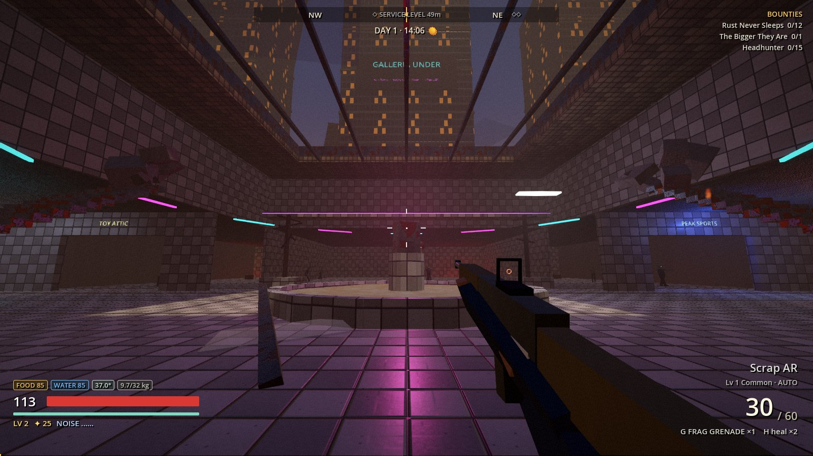
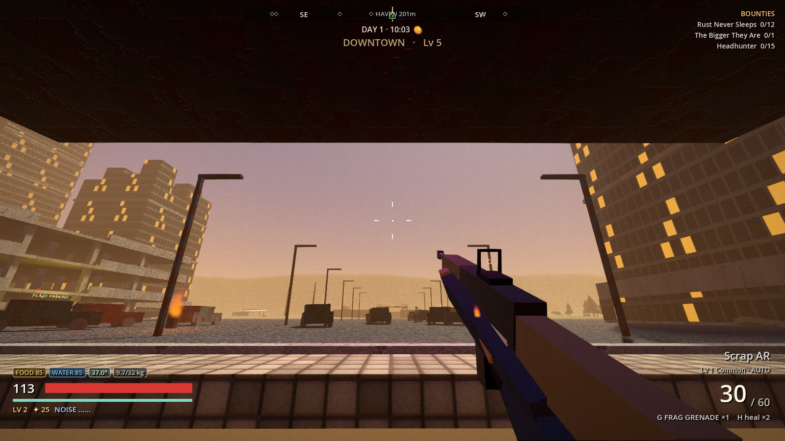
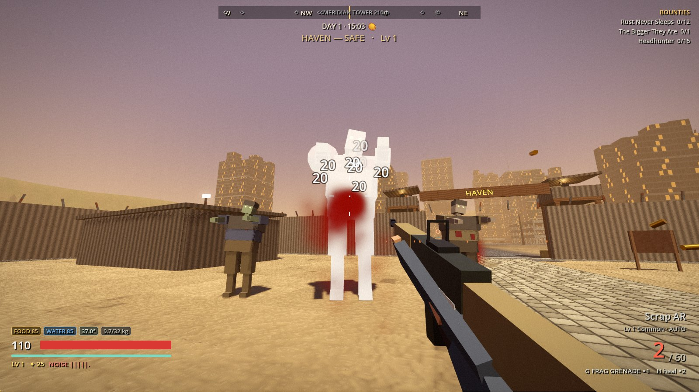
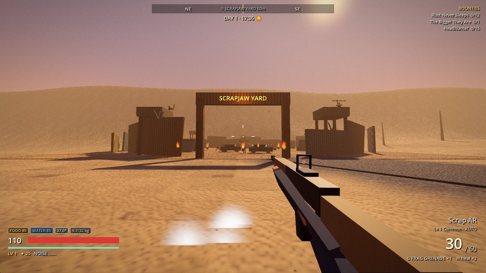
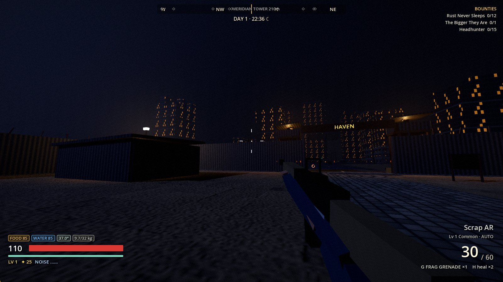
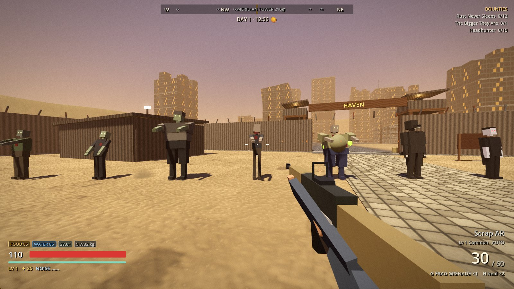
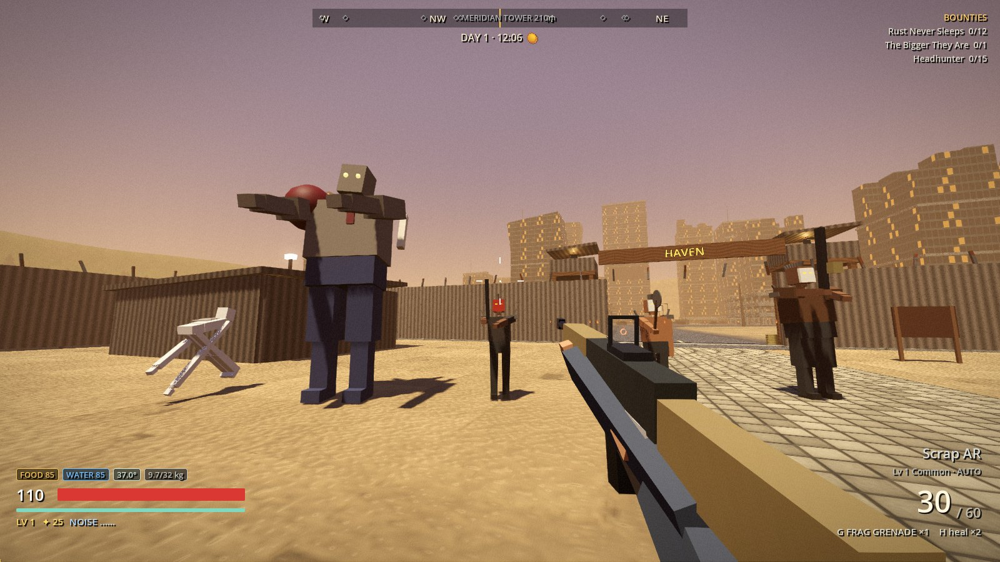
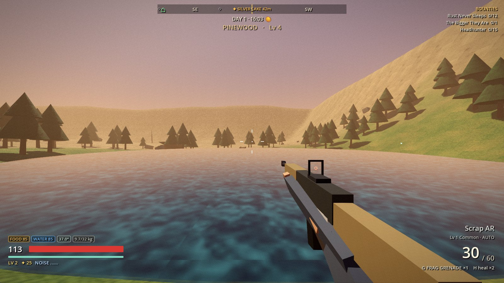
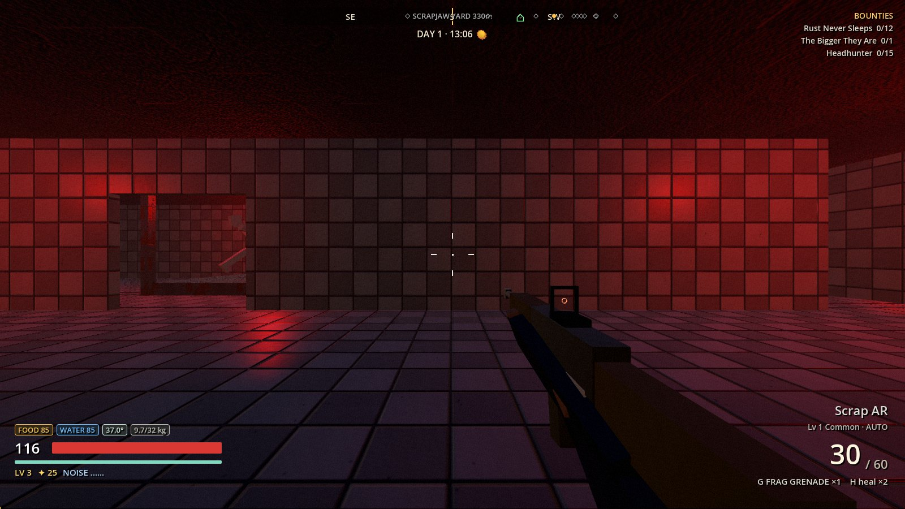

# RIOT TIMES

First-person survival looter-shooter in Godot 4.7. It mixes Fallout's wasteland mood,
Borderlands' raider lunatics and rarity loot, Mad Max scrap buggies, and DayZ/Unturned zombie
hordes, with CoD/Fortnite-style gunplay tuned for a controller. You get one life per
survivor, and the world remembers you.



The full design (pillars, core loop, systems) is in **[docs/GAME_DESIGN.md](docs/GAME_DESIGN.md)**.

## Play

- **Windows build:** `build\RiotTimes\RiotTimes.exe`
- **From source:** open the folder in Godot **4.7.2** and press F5.
- **Rebuild the exe:** `build.bat` (or `build.bat debug`).

You start at **Haven**. The bounty board is by the north gate, Mags trades in the NE shack,
the workbench and kitchen are on the west side, and the bunkhouse (bed and stash) is SE.
Your buggy is parked by the east gate. Downtown is due north up the road.

## Controls

| Action | Controller (Xbox) | Keyboard / Mouse |
|---|---|---|
| Move / Look | LS / RS | WASD / Mouse |
| Sprint | L3 (toggle) | Shift |
| Jump · Mantle | A | Space |
| Crouch · Slide (while sprinting) | B | C / Ctrl |
| Aim / Fire | LT / RT | RMB / LMB |
| Reload | X (tap) | R |
| Interact · Loot · Drive | X (hold) | E |
| Swap weapon | Y | Q · 1 / 2 · wheel |
| Melee | R3 | V / Mouse 4 |
| Throw / Cycle throwable | RB / D-pad ↓ | G / T |
| Quick heal | LB | H |
| Flashlight · Headlights | D-pad ↑ | F |
| Horn (in vehicle) | D-pad ← | B |
| Menu (inventory, skills, survivor, bounties) | View | Tab |
| Pause | Menu | Esc |

Aim assist (slowdown, rotational tracking, ADS snap), look speed, ADS sensitivity, FOV,
invert-Y, vibration and damage numbers are in **Settings → Controls**.

## What's in this build

| System | Status |
|---|---|
| Gunplay: 9 weapon classes (pistol, revolver, SMG, AR, shotgun, DMR, sniper, LMG, silent crossbow) with per-gun recoil patterns, ADS zoom, bloom, tactical/empty reloads, swap and sprint-to-fire times | ✅ |
| Loot: Common→Legendary rarity, item levels, 11 perks, 15 named legendaries, physics drops with rarity beams | ✅ |
| Feel: hit markers, Borderlands damage numbers and crits, hit-stop, trauma shake, FOV punch, shell casings, tracers, muzzle flash, rumble, post-FX (damage, cold, sickness, curse vision) | ✅ |
| Melee (silent, stealth multiplier, cleave), throwables (frag, molotov, noisemaker) | ✅ |
| Movement: sprint, slide, slide-jump, crouch, mantle/vault, landing, fall damage | ✅ |
| Noise system: gunfire, footsteps, engines and horns are heard; floors muffle sound | ✅ |
| Enemies: walker, runner, brute, screamer, bloater, Goliath, the Gaunt, werewolf, vampire, Scrapjaw gunner/psycho/King Gnasher, guards, boar, deer | ✅ |
| Director: population around you, horde rushes when you get comfortable, Haven sieges every 3rd night, night hunters | ✅ |
| World: Haven, Downtown plaza and skyscrapers, Meridian Tower ruin, drivable parking garage, the Galleria Under mall + sub-level, Camp Halberd + Black Site lab, Pinewood forest + lake + cabins, Scrapjaw Yard, gas station | ✅ |
| Survival: hunger, thirst, body temperature, weight/encumbrance, food poisoning, radiation | ✅ |
| Cooking (7 recipes), fishing, campfires | ✅ |
| Curses: the Rot / lycanthropy / vampirism → playable Hollow, Wolf and Vampire forms, cures | ✅ |
| Permadeath: memorial, graves with your gear, cursed bodies rise as named revenants, Haven stash survives | ✅ |
| Progression: levels 1–30, 3 skill trees + curse branch, backgrounds, bounties, trader, workbench upgrades | ✅ |
| Scrap buggy: fuel, hull damage, ram kills, headlights, horn, chase cam | ✅ |
| Day/night cycle (20 min), weather-free | ✅ |

**Not built yet (next steps, roughly in priority order):**
1. A tuning pass from real playtests. Every number (damage, recoil, hunger rates, spawn budgets) is a first pass.
2. Real art and audio: everything is procedural boxes and synthesized sound, so swapping in models and recorded audio is a content job, not a rewrite.
3. Haven upgrades and base building (designed, `world.haven` exists, no UI yet).
4. Smarter raiders (cover, flanking), more vehicle types, a world map screen.
5. Weather (rain, snow storms) and more diseases.
6. Optional third-person camera; multiplayer is out of scope for this codebase as it stands.

## Code map

| File | What it does |
|---|---|
| `scripts/Main.gd` | Title → creator → loading → game flow, pause, mouse capture, dev switches |
| `scripts/InputSetup.gd` | Builds the whole InputMap (pad + KB/M), button glyphs |
| `scripts/GameData.gd` | The survivor (one life) and the persistent world: needs, curses, inventory, skills, bounties, death, saves |
| `scripts/ItemDB.gd` | Weapons/melee/armor/consumables, rarity and perk rolls, loot tables, procedural icons |
| `scripts/Skills.gd` | Skill tree definitions |
| `scripts/Player.gd` | Movement, weapons state machine, recoil/ADS/bloom, melee, throwables, healing, fishing, camera juice |
| `scripts/AimAssist.gd` | Controller slowdown, rotational tracking, ADS snap |
| `scripts/Viewmodels.gd` | Procedural first-person guns, melee weapons, claws |
| `scripts/Combat.gd`, `FireZone.gd`, `Projectile.gd`, `Throwable.gd` | Tracers, impacts, damage numbers, explosions, fire/gas, bolts, grenades |
| `scripts/Monster.gd`, `MonsterBodies.gd` | All AI (perception, hearing, navmesh, specials, death) and procedural bodies |
| `scripts/Director.gd` | Clock, spawns, horde rushes, sieges, night hunters |
| `scripts/World.gd`, `WorldBuilder.gd`, `Poi*.gd` | Terrain, batched geometry + occluders, POIs, lighting, zones, navmesh baking |
| `scripts/Interactable.gd`, `LootPickup.gd`, `Vehicle.gd` | Containers/stations/graves, drops, the buggy |
| `scripts/HUD.gd`, `GameMenu.gd` | HUD and the controller-navigable menus/stations |
| `scripts/Noise.gd` | `Hearing` autoload: noise events |

The previous version (v1) is preserved in `_backup_v1/`. Godot ignores it.

## Tests

```bash
"C:/Tools/Godot/Godot_v4.7.2-stable_win64_console.exe" --headless --path . res://scenes/Test.tscn
```

45 checks. It builds the world, shoots, melees, reloads, slides, loots, cooks, gets cursed and
cured, drives, wakes the Gaunt, triggers a horde, explodes, saves/loads, bakes navmeshes and
dies permanently. It backs up and restores your real saves around the run.

## Dev switches (environment variables)

`RT_DEBUG_AUTOSTART=1` skip the title · `RT_DEBUG_FRESH=1` new survivor · `RT_DEBUG_BG=hunter`
background · `RT_DEBUG_SPAWN=plaza|mall|atrium|sublevel|military|lab|raiders|forest|downtown|garage|meridian|gas`
· `RT_DEBUG_TIME=22` hour · `RT_DEBUG_GOD=1` · `RT_NO_HORDES=1` · `RT_DEBUG_FPS=1` frame stats ·
`RT_DEBUG_SHOTS=1` screenshots to `user://shots` · `RT_DEBUG_ZOO=walker,gaunt,...` frozen line-up ·
`RT_DEBUG_AUTOFIRE=1` · `RT_DEBUG_QUIT_AFTER=10`

| | |
|---|---|
|  |  |
|  |  |
|  |  |
|  |  |
